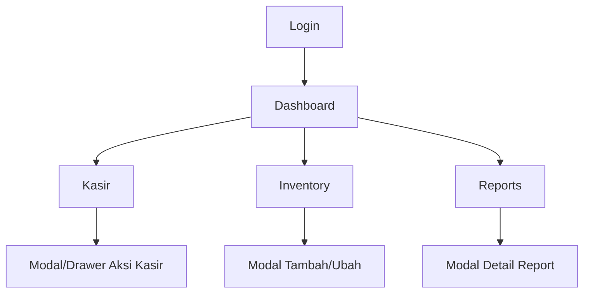

## 1. Product Overview
Membuat UI KasirKu Web yang ramah tablet & smartphone untuk halaman Login, Dashboard, Kasir, Inventory, dan Reports.
Fokus utama: layout responsif, pola navigasi adaptif, serta komponen tabel dan modal yang nyaman dipakai layar kecil.

## 2. Core Features

### 2.1 User Roles
| Role | Registration Method | Core Permissions |
|------|---------------------|------------------|
| Admin/Owner | Login akun yang sudah tersedia | Akses semua halaman (Dashboard, Inventory, Reports, Kasir) |
| Kasir | Login akun yang sudah tersedia | Fokus operasional transaksi di halaman Kasir (dan akses terbatas bila diperlukan) |

### 2.2 Feature Module
Kebutuhan UI responsif terdiri dari halaman berikut:
1. **Login**: form login responsif, validasi, state loading/error, tata letak ramah mobile.
2. **Dashboard**: ringkasan dalam kartu (cards), grafik/summary area yang reflow, navigasi responsif.
3. **Kasir**: layout 2 panel (produk/keranjang) yang adaptif, tabel item keranjang, modal pencarian/aksi.
4. **Inventory**: tabel data produk/stok responsif, pencarian/filter, modal tambah/ubah, pagination.
5. **Reports**: tabel laporan responsif, filter tanggal/rentang, modal detail.

### 2.3 Page Details
| Page Name | Module Name | Feature description |
|-----------|-------------|---------------------|
| Login | Responsive Layout | Menampilkan layout 1 kolom di mobile dan panel terpusat di desktop; menjaga jarak (spacing) dan ukuran target sentuh (touch target) minimum. |
| Login | Form & Validation | Menginput kredensial; menampilkan validasi inline; menampilkan state loading; menampilkan error yang jelas. |
| Login | Keyboard & Accessibility | Mengatur urutan fokus (tab order), enter untuk submit, dan hint agar tidak terpotong saat keyboard mobile muncul. |
| Dashboard | Responsive Navigation | Menyediakan navigasi desktop (sidebar/topbar) dan mobile (hamburger/bottom navigation) tanpa mengubah tujuan halaman. |
| Dashboard | Summary Cards | Menampilkan kartu ringkasan yang berubah dari grid multi-kolom (desktop) menjadi 1–2 kolom (tablet/mobile). |
| Dashboard | Table/List Snapshot | Menampilkan ringkasan tabel/list (bila ada) dengan perilaku responsif: truncate teks, wrap, dan overflow yang aman. |
| Kasir | Adaptive Work Area | Mengatur area kerja: desktop 2 kolom (produk vs keranjang), tablet menjadi split yang lebih rapat, mobile menjadi bertingkat (stack) dengan switcher/tab. |
| Kasir | Cart Table (Responsive) | Menampilkan item keranjang dalam tabel: sticky header, kolom prioritas, respons overflow horizontal bila perlu, serta kontrol jumlah yang nyaman disentuh. |
| Kasir | Modal/Drawer Actions | Membuka modal untuk pencarian produk/konfirmasi aksi; di mobile tampil sebagai full-screen modal atau bottom-sheet. |
| Inventory | Data Table (Responsive) | Menampilkan tabel stok/produk dengan: pencarian, filter, sort dasar, pagination; kolom dapat disembunyikan/diringkas di mobile. |
| Inventory | CRUD Modal | Menambah/mengubah item via modal; di mobile modal full-screen dengan header tetap dan tombol aksi jelas. |
| Inventory | Empty/Error States | Menampilkan state kosong, loading skeleton, dan error dengan CTA ulangi. |
| Reports | Filter Bar (Responsive) | Menyediakan filter (tanggal/rentang/jenis laporan) yang berubah dari bar horizontal (desktop) ke accordion/stack (mobile). |
| Reports | Report Table + Detail | Menampilkan tabel laporan responsif dan membuka detail (modal/drawer) yang mudah dibaca di layar kecil. |
| Reports | Export/Print Entry Point | Menyediakan entry point aksi (jika ada) dalam menu overflow agar tidak memenuhi header di mobile. |

## 3. Core Process
**Alur Admin/Owner**: Buka Login → masuk → tiba di Dashboard → gunakan navigasi untuk ke Inventory/Reports/Kasir → gunakan tabel untuk mencari data → buka modal untuk detail atau tambah/ubah data.

**Alur Kasir**: Buka Login → masuk → ke Kasir → gunakan area produk untuk memilih item → lihat keranjang dalam tabel responsif → gunakan modal/drawer untuk pencarian atau konfirmasi aksi.

