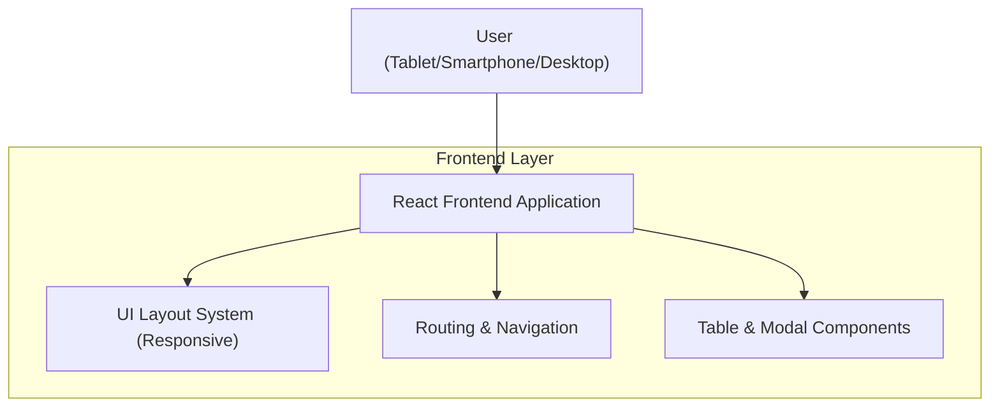

## 1.Architecture design

## 2.Technology Description
- Frontend: React@18 + TypeScript + React Router + tailwindcss@3
- Backend: None (dokumen ini fokus UI responsif; integrasi auth/data mengikuti backend yang sudah ada)
- UI utilities (opsional namun relevan):
  - TanStack Table (untuk tabel kompleks & responsif)
  - Headless UI / Radix UI (untuk modal/dialog yang aksesibel)

## 3.Route definitions
| Route | Purpose |
|-------|---------|
| /login | Autentikasi pengguna dan entry point aplikasi |
| /dashboard | Ringkasan utama dan akses cepat ke modul |
| /kasir | Area transaksi kasir dengan layout adaptif |
| /inventory | Manajemen item/stok berbasis tabel responsif |
| /reports | Laporan dan detail berbasis tabel + modal |
